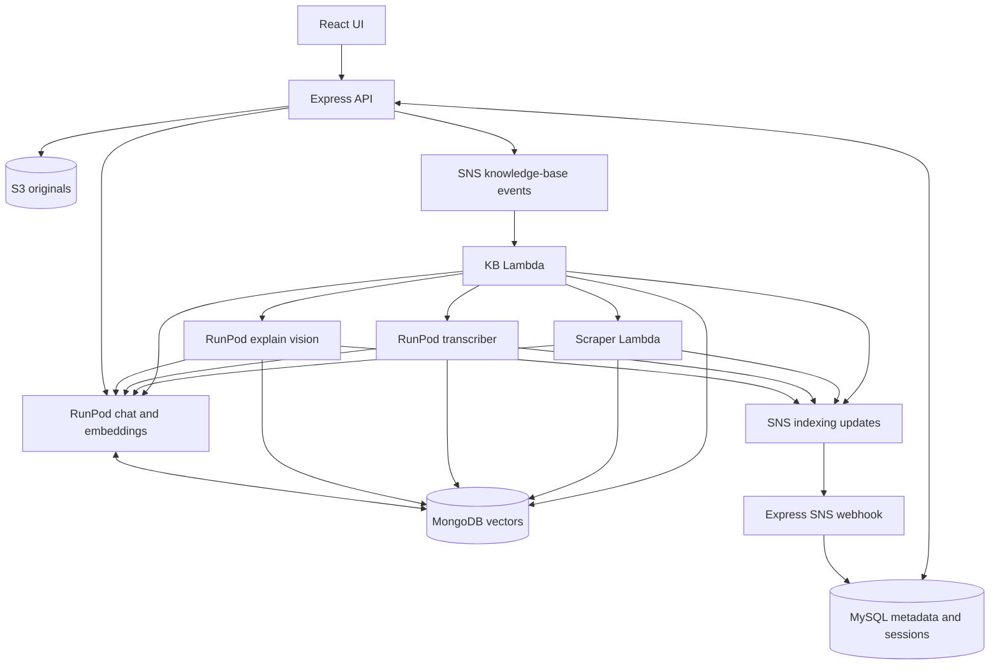

# Architecture and complete service inventory

[Documentation home](../../README.md)

## Runtime components

| Component | Runs where | Responsibility | Required for |
| --- | --- | --- | --- |
| React single-page application | Static HTTPS host/CDN | Dashboard, KB upload, chat, workflow editor | Browser UI |
| Express TypeScript API | Persistent Node process behind HTTPS | JWT/OAuth, MySQL metadata, S3 upload, SNS publish, chat dispatch, workflow execution, SNS webhook | Entire web product |
| MySQL 8+ | Managed database or server | Users, ownership, content status, assistants, connectors, messages, workflows, execution state | Web API |
| MongoDB Atlas with Vector Search | MongoDB Atlas | Embedded chunks, restricted queries, URL trees, optional key/custom-DB records | RAG and ingestion |
| S3 bucket | AWS, baseline us-east-1 | Original uploaded documents and media, signed reference access | Uploaded content |
| Knowledge-base SNS topic | AWS SNS | ADD_FILE, DELETE_FILE, DELETE_KNOWLEDGEBASE dispatch | Asynchronous ingestion |
| Knowledge-base Python Lambda | AWS Lambda container image from ECR | Parse documents/text, route media, orchestrate crawl, delete vectors | All KB content types |
| Scraper Python Lambda | AWS Lambda container image from ECR | Headless browser extraction, links, chunks and embeddings | Website knowledge |
| Indexing-update SNS topic | AWS SNS | Processing/completion/failure and extraction metadata | Web status synchronization |
| HTTPS SNS subscriber | Express `/knowledgebase/webhook` | Update MySQL from worker status events | End-to-end UI status |
| Chat-all-models worker | RunPod serverless GPU | Stella embeddings/retrieval, query rewrite, Mongo vector retrieval, GemFilter and generation | Default chat and ALL vector ingestion |
| Transcriber worker | RunPod serverless GPU | ASR, optional speaker diarization, transcript chunks/indexing | Audio |
| Explain-vision worker | RunPod serverless GPU | Image descriptions, sampled video scene descriptions, video speech/indexing | Images/video |
| Container registry | ECR for Lambda; Docker Hub or compatible registry for RunPod | Store deployable images | Build/release |
| `devWoiceChat` compatibility Lambda | AWS, optional path | Third-party provider chat and credential validation in current web code | OpenAI/Gemini/Cerebras connectors |
| Google OAuth application | Google, optional | Google login | Social login only |
| Provider APIs | Optional external services | Third-party chat | Selected provider only |

ECR stores images; it does not run Python workers. No separate Redis, queue worker process, Elasticsearch, Pinecone, or vector microservice is required by the inspected active code. No separate always-on Python HTTP service is needed: Flask files are local wrappers; Lambda and RunPod are the deployment entrypoints.

## Data flow

## Recorded deployment identifiers

Owner supplied; not health-checked:

| Resource | Recorded value |
| --- | --- |
| Transcriber endpoint | `qiyoo5d0h7hz03` |
| Chat/embedding endpoint | `t7pk7qccoaohob` |
| Explain vision endpoint | `7xd368vozr5r44` |
| Knowledge bucket | `woice.ai-knowledgebase-centeral-bucket` (spelling preserved) |
| AWS account / region in code | `471112754613` / `us-east-1` |
| Input SNS topic | `arn:aws:sns:us-east-1:471112754613:woice-ai-knowledgebase` |
| Update SNS topic | `arn:aws:sns:us-east-1:471112754613:lambda-indexing-update-events` |

These are historical installation coordinates, not portable defaults for someone else's account. New installations must replace source constants as well as environment variables.

## Active and compatibility paths

The owner reports `chat-all-models` as the major working chat backend. In the web snapshot, `llmName === 'qwen'` calls RunPod directly; all other providers and key validation call `devWoiceChat`. Therefore a default-Qwen installation can avoid that chat Lambda, while a feature-complete installation of this web snapshot cannot assume it is unused. The public RunPod handler does not implement provider dispatch merely because the branch is named chat-all-models.

The owner confirmed React + Express as the production web baseline. Laravel and Next.js are excluded from this service inventory and deployment.

Sources: [backend/src/index.ts](https://github.com/asdkazmi/woiceai-web/blob/8520c824ad0bf2ae9ad403fdca358757c1be98ae/backend/src/index.ts), [backend/src/services/chatAIService.ts](https://github.com/asdkazmi/woiceai-web/blob/8520c824ad0bf2ae9ad403fdca358757c1be98ae/backend/src/services/chatAIService.ts), [woice_kb/src/handler.py](https://github.com/asdkazmi/woiceai-ai/blob/0e81e4185613358646292ccb5e0fdcbca639febf/woice_kb/src/handler.py), [chat-with-all-models/src/handler.py](https://github.com/asdkazmi/woiceai-ai/blob/699361213594230ce1a4bad9085eeb657e5a8e8a/chat-with-all-models/src/handler.py).
